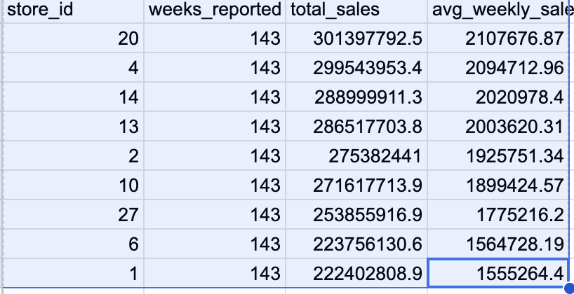
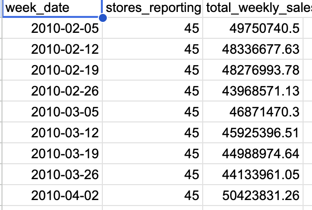
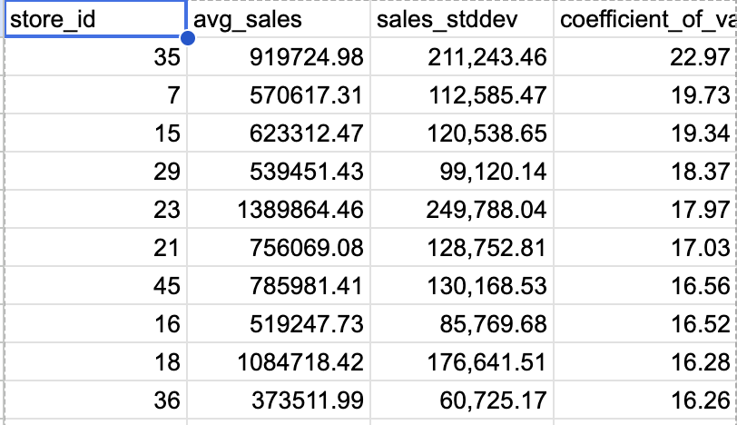
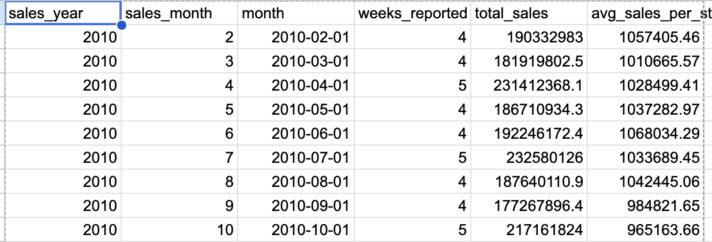

### Business Question 1: Store Performance

Which Walmart stores generated the highest total sales
between February 2010 and October 2012?

**SQL Results:**

---

### Business Question 2: Weekly Sales Trends

How did Walmart's total weekly sales change over time, and which weeks experienced the highest and lowest sales?

**SQL Results:**

**Business Insight:**

Add your findings about the highest and lowest sales weeks and notable trends.

---

### Business Question 3: Holiday Sales Performance

Do Walmart stores generate higher average weekly sales during holiday weeks compared with non-holiday weeks?

**SQL Results:**

**Business Insight:**

Compare holiday and non-holiday average sales and explain the difference.

---

### Business Question 4: Monthly Sales Seasonality

Which months experienced the highest average weekly sales, and were there recurring seasonal patterns across 2010, 2011, and 2012?

**SQL Results:**

**Business Insight:**

Identify the strongest months and any recurring seasonal patterns.

---

### Business Question 5: Store Sales Variability

Which Walmart stores experienced the greatest fluctuations in weekly sales, and which maintained the most consistent sales performance?

**SQL Results:**

**Business Insight:**

Identify the most and least variable stores and explain the operational implications.
